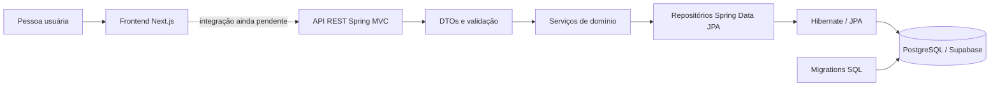

# Mapa atual do projeto +Arte

**Atualizado em:** 26 de outubro de 2026  
**Escopo:** fotografia do código e dos arquivos presentes no repositório nesta data. Este documento descreve o que está implementado, não substitui as decisões de produto nem garante que o banco remoto esteja no mesmo estado.

## 1. O que é o +Arte

O +Arte é uma plataforma colaborativa para divulgar e organizar a cena cultural de Curitiba. Seu domínio principal reúne artistas, bandas, espaços culturais e eventos. A regra importante do modelo de eventos é que cada evento tem seu próprio endereço e pode ocorrer em um espaço cultural, em vários ou em nenhum — o que permite representar apresentações em espaços públicos, como batalhas de rima na rua.

O repositório reúne o frontend web, o backend Java, as migrations do PostgreSQL e os padrões de governança do projeto. O backend já expõe uma API REST Java; a integração entre essa API e o frontend ainda não está implementada.

## 2. Visão de arquitetura



O frontend e o backend são módulos separados. O navegador renderiza o Next.js; quando a integração for feita, o frontend deverá chamar a API Java, e a API acessará o PostgreSQL por JDBC, Spring Data JPA e Hibernate. O Supabase é utilizado como serviço PostgreSQL hospedado; a aplicação Java não depende do cliente Supabase nem de sua API REST para persistência.

## 3. Estrutura do repositório

```text
mais-arte-teste-back/
├── .github/
│   ├── ISSUE_TEMPLATE/
│   ├── workflows/
│   └── pull_request_template.md
├── .vscode/
│   └── mcp.json
├── .agents/
│   └── skills/
├── back/
│   ├── pom.xml
│   ├── .env                  # configuração local; não documentar nem versionar valores
│   ├── src/main/java/        # aplicação Spring, API, domínio e persistência
│   ├── src/main/resources/   # configuração Spring
│   ├── src/test/java/        # testes Java
│   └── supabase/migrations/  # schema PostgreSQL
├── docs/
│   └── processo/             # governança e fluxo de contribuição
├── frontend/
│   ├── package.json
│   ├── pnpm-lock.yaml
│   └── src/
├── LICENSE
├── README.md
├── CONTRIBUTING.md
└── MAPA-DO-PROJETO.md
```

### Diretórios e arquivos relevantes

| Local | Responsabilidade atual |
| --- | --- |
| [`back/src/main/java/br/com/maisarte/backend`](./back/src/main/java/br/com/maisarte/backend) | Código Java do backend. |
| [`back/src/main/java/br/com/maisarte/backend/controller`](./back/src/main/java/br/com/maisarte/backend/controller) | Endpoints REST e adaptação de requisições/respostas. |
| [`back/src/main/java/br/com/maisarte/backend/dto`](./back/src/main/java/br/com/maisarte/backend/dto) | Contratos de entrada/saída HTTP e validações de entrada. |
| [`back/src/main/java/br/com/maisarte/backend/servico`](./back/src/main/java/br/com/maisarte/backend/servico) | Regras do domínio, casos de uso e transações. |
| [`back/src/main/java/br/com/maisarte/backend/repositorio`](./back/src/main/java/br/com/maisarte/backend/repositorio) | Interfaces Spring Data JPA para consulta e persistência. |
| [`back/src/main/java/br/com/maisarte/backend/entidade`](./back/src/main/java/br/com/maisarte/backend/entidade) | Entidades ORM e relacionamentos persistidos. |
| [`back/supabase/migrations`](./back/supabase/migrations) | Scripts SQL que constroem ou alteram o schema PostgreSQL. |
| [`frontend/src/app`](./frontend/src/app) | Rotas e layouts Next.js. |
| [`frontend/src/_components`](./frontend/src/_components) | Componentes compartilhados da interface. |
| [`docs/processo`](./docs/processo) | Definition of Ready/Done, branches, commits, PRs, revisão e política de IA. |
| [`.github/workflows/ci.yml`](./.github/workflows/ci.yml) | Verificações de estrutura no GitHub Actions para `main` e `development`. |
| [`.vscode/mcp.json`](./.vscode/mcp.json) | Configuração do MCP do Supabase para ferramentas de desenvolvimento. Não é a configuração JDBC do backend. |

O `README.md` raiz contém a visão do produto e as regras de contribuição. A árvore de exemplo nele apresentada ainda cita diretórios e documentos que não aparecem na estrutura atual; use esta seção e o conteúdo versionado como referência do estado presente.

## 4. Backend Java

### 4.1 Stack e inicialização

O backend usa Java 17, Spring Boot 3.5.6, Spring MVC, Spring Data JPA, Hibernate, Jakarta Validation e PostgreSQL. As dependências e o plugin de execução estão definidos em [`back/pom.xml`](./back/pom.xml). A classe que inicia o contexto Spring é [`AplicacaoMaisArte`](./back/src/main/java/br/com/maisarte/backend/AplicacaoMaisArte.java).

[`application.yml`](./back/src/main/resources/application.yml) importa opcionalmente `back/.env`, recebe `DATABASE_URL`, `DATABASE_USERNAME` e `DATABASE_PASSWORD` e configura o Hibernate com `ddl-auto: validate`. Sem variáveis configuradas, há valores padrão para PostgreSQL local em `127.0.0.1:5432/mais_arte`; o início da aplicação ainda depende de existir um banco acessível com schema compatível.

`validate` verifica se o schema existente corresponde ao mapeamento JPA. Não cria tabelas nem aplica migrations. As migrations precisam ser executadas separadamente e na ordem apropriada.

### 4.2 Caminho de uma requisição

O fluxo implementado para a API é:

1. Um controller recebe a requisição HTTP e desserializa o corpo JSON em um DTO de cadastro.
2. `@Valid` aciona as restrições Jakarta Validation declaradas nesse DTO.
3. O controller converte o DTO de entrada em uma entidade e chama o serviço correspondente.
4. O serviço executa a regra de domínio e usa o repositório Spring Data.
5. JPA/Hibernate converte as operações da entidade em operações PostgreSQL.
6. O controller converte a entidade retornada em DTO de saída. As entidades JPA não são usadas como resposta HTTP.
7. [`ApiErrorHandler`](./back/src/main/java/br/com/maisarte/backend/api/ApiErrorHandler.java) traduz erros de validação em respostas `400` e `ErroRecursoNaoEncontrado` em `404`.

Exemplo simplificado do padrão de cadastro:

```java
@PostMapping
public ResponseEntity<EventoDto> criar(@Valid @RequestBody EventoCadastroDto dto) {
    Evento evento = servicoEventos.salvar(dto.toEntity(), dto.espacosCulturais());
    return ResponseEntity.status(HttpStatus.CREATED).body(EventoDto.fromEntity(evento));
}
```

Assim, os detalhes de persistência ficam no domínio e o contrato JSON pode evoluir sem serializar diretamente os objetos JPA.

### 4.3 Endpoints presentes no código

As rotas abaixo são definidas pelos controllers em `/api`. A existência do endpoint no código não significa que o frontend já o consuma ou que a conexão com o banco remoto tenha sido validada.

| Recurso | Método e rota | Comportamento |
| --- | --- | --- |
| Artistas | `GET /api/artistas` | Lista artistas ativos. |
| Artistas | `GET /api/artistas/{id}` | Busca um artista ativo. |
| Artistas | `GET /api/artistas/destaques?limite=10` | Lista artistas ativos e verificados. |
| Artistas | `POST /api/artistas` | Cria artista; retorna `201` e DTO. |
| Artistas | `PUT /api/artistas/{id}` | Atualiza os campos enviados; retorna DTO. |
| Artistas | `DELETE /api/artistas/{id}` | Desativa o artista; retorna `204`. |
| Bandas | `GET /api/bandas` | Lista bandas ativas. |
| Bandas | `GET /api/bandas/{id}` | Busca uma banda ativa. |
| Bandas | `GET /api/bandas/pesquisa?termo=...&limite=10` | Pesquisa bandas ativas. |
| Bandas | `POST /api/bandas` | Cria banda; retorna `201` e DTO. |
| Bandas | `PUT /api/bandas/{id}` | Atualiza os campos enviados; retorna DTO. |
| Bandas | `DELETE /api/bandas/{id}` | Desativa a banda; retorna `204`. |
| Espaços culturais | `GET /api/espacos-culturais` | Lista espaços culturais ativos. |
| Espaços culturais | `GET /api/espacos-culturais/{id}` | Busca um espaço ativo. |
| Espaços culturais | `GET /api/espacos-culturais/destaques?limite=10` | Lista espaços ativos e verificados. |
| Espaços culturais | `POST /api/espacos-culturais` | Cria espaço; retorna `201` e DTO. |
| Espaços culturais | `PUT /api/espacos-culturais/{id}` | Atualiza os campos enviados; retorna DTO. |
| Espaços culturais | `DELETE /api/espacos-culturais/{id}` | Desativa o espaço; retorna `204`. |
| Eventos | `GET /api/eventos` | Lista eventos ativos. |
| Eventos | `GET /api/eventos/{id}` | Busca evento ativo por identificador. |
| Eventos | `GET /api/eventos/proximos?limite=10` | Lista eventos a partir da data atual, ordenados por data e hora. |
| Eventos | `POST /api/eventos` | Cria evento; recebe endereço obrigatório e IDs opcionais de espaços. Retorna `201`. |
| Eventos | `PUT /api/eventos/{id}` | Pretende atualizar evento, mas o código atual não copia o ID existente para a nova entidade antes de salvar. Não se deve presumir que essa rota atualize em vez de inserir. |
| Eventos | `DELETE /api/eventos/{id}` | Desativa o evento; retorna `204`. |

Nos endpoints com `limite`, o valor padrão definido no controller é 10. O limite é encaminhado como paginação pelo serviço; não há um limite máximo explícito configurado nos controllers.

O serviço [`ServicoBuscaCatalogo`](./back/src/main/java/br/com/maisarte/backend/servico/ServicoBuscaCatalogo.java) agrega resultados de artistas, bandas, espaços e eventos e os ordena por pontuação e nome, mas atualmente não há controller que exponha essa busca unificada. Também não existe endpoint de busca de artistas, espaços ou eventos nos controllers atuais.

### 4.4 Serviços e regras

- [`ServicoArtistas`](./back/src/main/java/br/com/maisarte/backend/servico/ServicoArtistas.java), [`ServicoBandas`](./back/src/main/java/br/com/maisarte/backend/servico/ServicoBandas.java) e [`ServicoEspacosCulturais`](./back/src/main/java/br/com/maisarte/backend/servico/ServicoEspacosCulturais.java) concentram operações de listagem, busca por identificador, destaques quando definidos, gravação e desativação.
- [`ServicoEventos`](./back/src/main/java/br/com/maisarte/backend/servico/ServicoEventos.java) implementa a consulta de próximos eventos e valida que todos os IDs de espaços culturais recebidos existam antes de associá-los.
- O `DELETE` lógico muda `ativo` para `false`; não apaga a linha do banco.
- As classes de serviço usam `@Transactional`; métodos de consulta são marcados como somente leitura.
- [`ErroRecursoNaoEncontrado`](./back/src/main/java/br/com/maisarte/backend/servico/ErroRecursoNaoEncontrado.java) representa o recurso inexistente ou inativo.
- `ServicoBuscaCatalogo` executa uma busca agregada e atribui pontuação simples: correspondência no nome recebe pontuação maior que correspondência apenas na descrição. O máximo atual é 20 resultados por tipo.

### 4.5 Persistência e repositórios

Os repositórios estendem `JpaRepository`, permitindo CRUD por Spring Data, com consultas JPQL para os filtros usados pelo domínio:

- [`RepositorioArtistas`](./back/src/main/java/br/com/maisarte/backend/repositorio/RepositorioArtistas.java)
- [`RepositorioBandas`](./back/src/main/java/br/com/maisarte/backend/repositorio/RepositorioBandas.java)
- [`RepositorioEspacosCulturais`](./back/src/main/java/br/com/maisarte/backend/repositorio/RepositorioEspacosCulturais.java)
- [`RepositorioEventos`](./back/src/main/java/br/com/maisarte/backend/repositorio/RepositorioEventos.java)

O repositório de eventos usa `@EntityGraph` ou `join fetch` em algumas consultas para carregar espaços relacionados sem depender de serialização de entidades no controller. A associação `Evento -> EspacoCultural` é lazy na entidade e muitos-para-muitos.

### 4.6 Modelo de domínio

[`EntidadeConteudoBase`](./back/src/main/java/br/com/maisarte/backend/entidade/EntidadeConteudoBase.java) é uma `@MappedSuperclass` compartilhada por artista, banda, espaço cultural e evento. Seus campos são foto principal, reputação, verificação e estado ativo.

| Entidade Java | Tabela PostgreSQL | Dados próprios principais |
| --- | --- | --- |
| `Artista` | `public.perfil_artista` | Nome artístico, biografia, início de atividade e gêneros musicais (`jsonb`). |
| `Banda` | `public.banda` | Nome, descrição, data de formação e gêneros musicais (`jsonb`). |
| `EspacoCultural` | `public.espaco_cultural` | Nome, descrição, site, horário (`jsonb`), capacidade, indicação de espaço público e endereço textual opcional. |
| `Evento` | `public.evento` | Nome, descrição, data, horários, cartaz, ingresso, preço e endereço textual obrigatório. |

Relacionamentos relevantes:

```text
Evento 0..N <-> 0..N Espaço cultural
              evento_espaco_cultural
```

O endereço do evento é texto pertencente ao próprio evento. A tabela `endereco` que aparece nas migrations intermediárias foi removida pela migration 0005; não existe entidade Java `Endereco` na estrutura atual. O campo de endereço de um espaço cultural é independente do endereço obrigatório do evento.

Exemplo do mapeamento de evento:

```java
@NotBlank
@Column(nullable = false, columnDefinition = "text")
private String endereco;

@ManyToMany(fetch = FetchType.LAZY)
@JoinTable(
    name = "evento_espaco_cultural",
    schema = "public",
    joinColumns = @JoinColumn(name = "id_evento"),
    inverseJoinColumns = @JoinColumn(name = "id_espaco_cultural"))
private Set<EspacoCultural> espacosCulturais = new LinkedHashSet<>();
```

O endereço é obrigatório, enquanto a coleção de espaços é inicializada vazia. Portanto, o evento pode ser salvo sem espaço associado. Quando IDs são enviados, o serviço verifica se todos existem e recusa a gravação se algum não for encontrado.

### 4.7 DTOs e validação

Cada recurso possui DTO de leitura e DTO de cadastro/atualização, por exemplo [`EventoDto`](./back/src/main/java/br/com/maisarte/backend/dto/EventoDto.java) e [`EventoCadastroDto`](./back/src/main/java/br/com/maisarte/backend/dto/EventoCadastroDto.java). Nos DTOs de entrada, as anotações incluem `@NotBlank`, `@NotNull`, `@Size` e `@DecimalMin`, conforme o campo. O controller ativa essas verificações com `@Valid`.

Exemplo:

```java
@NotBlank(message = "O endereço do evento é obrigatório.")
String endereco
```

O tratamento atual de erros expõe um corpo JSON com `timestamp`, `status`, `error` e `message`. A API ainda não define um contrato de erro mais amplo ou específico por campo.

## 5. Banco de dados e Supabase

### 5.1 Conexão da aplicação

O caminho da aplicação Java até o banco é:

```text
Spring Boot -> JDBC PostgreSQL -> PostgreSQL hospedado no Supabase
```

As variáveis esperadas são:

```dotenv
DATABASE_URL=jdbc:postgresql://<host>:<porta>/<database>
DATABASE_USERNAME=<usuario do banco>
DATABASE_PASSWORD=<senha do banco>
```

O arquivo local `.env` deve permanecer ignorado pelo Git. Não coloque senhas, tokens, chaves Supabase ou URLs com credenciais neste documento. `SUPABASE_URL` e chaves de API não substituem as credenciais JDBC.

### 5.2 Histórico das migrations

Os scripts em [`back/supabase/migrations`](./back/supabase/migrations) representam etapas do modelo:

1. `0001_mvp.sql` cria o schema inicial, incluindo artistas, bandas, espaços e eventos. No modelo inicial, evento tinha associação obrigatória direta com espaço.
2. `0002_ajustes_evento.sql` adiciona campo de foto principal ao evento.
3. `0003_endereco_evento_espacos.sql` introduz endereço estruturado e migra o vínculo evento-espaço para uma tabela de associação que aceita múltiplos espaços.
4. `0004_ajustes_espaco_cultural.sql` adiciona foto principal e reputação ao espaço cultural.
5. `0005_modelo_endereco_texto.sql` consolida o endereço do evento em texto obrigatório e remove a tabela estruturada de endereço e a FK correspondente.
6. `0006_recriar_schema_java.sql` contém uma recriação completa do schema final do Java. O script tenta interromper a execução se encontrar dados nas tabelas principais, depois remove e recria tabelas, índices, políticas e relações. Não é uma migration incremental de rotina.

**Atenção:** a migration 0006 contém `DROP TABLE`. Antes de executá-la, confirme o projeto e o ambiente Supabase, confira as tabelas e os dados, faça backup e obtenha aprovação explícita. O arquivo presente no repositório não prova que foi aplicado no banco remoto. A configuração JPA `validate` também não aplica scripts SQL automaticamente.

Os scripts habilitam Row Level Security (RLS) e criam políticas de leitura pública para dados selecionados. Isso não substitui autenticação/autorização nos endpoints Java. Como a aplicação acessa PostgreSQL diretamente com as credenciais JDBC, o efeito efetivo das políticas depende do papel de banco utilizado; validar a política de acesso do Supabase é necessário antes de tratar RLS como barreira da API.

## 6. Frontend

### 6.1 Stack

O frontend em [`frontend`](./frontend) utiliza Next.js 16, React 19, TypeScript 5, Tailwind CSS 4 e `react-icons`. O gerenciador declarado em `package.json` é pnpm, com lockfile versionado.

### 6.2 Rotas e interface disponíveis

- `/` monta `Navbar`, `Destaques` e `Footer`.
- `/busca` renderiza barra de pesquisa e filtro; o handler `submit` está vazio e não consulta dados.
- `Navbar` apresenta links de eventos, artistas e espaços, além de pesquisa e imagem de conta. Os links de categorias apontam para a raiz no código atual.
- `Destaques` existe como componente, mas a seção renderizada está vazia.
- O rodapé contém links exploratórios, participação e institucionais, além de imagem decorativa. Várias dessas rotas ainda não existem na estrutura `app`.
- `layout.tsx` configura as fontes e os estilos globais; os metadados ainda são os valores genéricos “Create Next App”.
- Os componentes de busca, filtros, navegação, rodapé e carrossel estão em `frontend/src/_components`.

### 6.3 Integração com o backend

Não há cliente HTTP/API configurado nem chamadas às rotas Java no frontend atual. A pesquisa e a exibição de destaques não são alimentadas pelo banco. Também não foram encontrados no backend configuração de CORS, Spring Security ou endpoints de autenticação; esses pontos precisam ser definidos antes da integração web em ambiente real.

## 7. Como executar localmente

### Backend

Pré-requisitos: JDK 17+, Maven e PostgreSQL local ou Supabase acessível. Configure as três variáveis JDBC no ambiente ou no `back/.env` local e aplique o schema compatível antes de iniciar.

```powershell
cd back
mvn test
mvn spring-boot:run
```

Para criar um pacote:

```powershell
mvn package
```

O teste Java atualmente presente é `ServicoEventosTeste`. Ele testa a regra de salvar evento sem espaço, associar múltiplos espaços e exigir endereço; não é teste de integração com banco real.

### Frontend

Pré-requisitos: Node.js e pnpm compatível com a versão declarada no `package.json`.

```powershell
cd frontend
pnpm install --frozen-lockfile
pnpm dev
```

A aplicação de desenvolvimento do Next.js usa normalmente `http://localhost:3000`. Os comandos disponíveis também incluem `pnpm build`, `pnpm start` e `pnpm lint`.

### Verificação do schema

Ao iniciar o Spring, o Hibernate valida o mapeamento contra o schema configurado. Se as tabelas ou colunas divergirem, o contexto falha em vez de alterar o banco. Para alterações de banco, use e revise migrations; não habilite `ddl-auto: update` como atalho em banco compartilhado.

## 8. Governança e automação

O projeto utiliza issues, pull requests, Conventional Commits, revisão de código e definições de pronto e concluído. As instruções estão em [`CONTRIBUTING.md`](./CONTRIBUTING.md) e em [`docs/processo`](./docs/processo). A licença atual é proprietária; leia [`LICENSE`](./LICENSE) antes de reutilizar ou redistribuir conteúdo.

O workflow [`ci.yml`](./.github/workflows/ci.yml) verifica arquivos e diretórios de governança em pushes e pull requests direcionados a `main` e `development`. O workflow consultado não executa Maven, testes Java, build do frontend nem lint. Portanto, não representa por si só validação funcional dos módulos.

As skills em `.agents/skills` e a configuração MCP em `.vscode` são recursos de desenvolvimento assistido; não fazem parte do caminho de execução da aplicação.

## 9. O que está feito e o que falta

### Implementado no código atual

- Backend Java com Spring Boot, Spring MVC, Hibernate/JPA e driver PostgreSQL.
- Entidades para artista, banda, espaço cultural e evento.
- Repositórios Spring Data JPA e serviços de domínio.
- Endereço obrigatório no evento e associação opcional de zero a vários espaços culturais.
- Controllers CRUD iniciais, DTOs de entrada/saída e validação Jakarta.
- Soft delete por campo `ativo`.
- Migrations PostgreSQL até a recriação de schema da versão Java.
- Frontend Next.js com estrutura visual inicial de página, busca, navegação e rodapé.

### Ainda não implementado ou não confirmado

- Comunicação do frontend com a API Java e fluxo end-to-end com PostgreSQL.
- Autenticação, autorização e política CORS para os endpoints.
- Endpoint/controller para a busca unificada já existente em `ServicoBuscaCatalogo`.
- Endpoint de pesquisa de artistas, espaços e eventos; o endpoint de pesquisa existente é apenas de bandas.
- Fluxos completos de criação e edição no frontend.
- Testes de integração com PostgreSQL/Supabase e testes HTTP dos controllers.
- Aplicação confirmada da migration 0006 e validação da conexão Java com o banco remoto.
- Documentação de produto e domínio listada na árvore ilustrativa do README raiz, mas ausente na estrutura efetivamente verificada.

Há uma divergência documental adicional: [`back/README.md`](./back/README.md) ainda descreve a etapa anterior, afirmando que não existem controllers nem servidor HTTP. Os controllers REST estão presentes no código atual; o estado deste mapa reflete os arquivos Java consultados, não essa descrição desatualizada.

## 10. Decisões de domínio a preservar

1. Um evento possui um endereço próprio obrigatório.
2. Um evento pode ter zero, um ou vários espaços culturais associados.
3. A associação a espaço cultural não deve ser usada para inferir o endereço do evento.
4. Remoção de conteúdo é lógica (`ativo = false`) para preservar os dados.
5. A aplicação Java conversa com PostgreSQL usando JDBC; chaves da API Supabase não são credenciais de conexão JDBC.
6. Entidades ORM devem permanecer internas ao backend. Os controllers devem continuar respondendo com DTOs.

---

Este mapa é um guia de navegação e entendimento do estado observado. Ao mudar rotas, schema, stack ou integração, atualize as seções correspondentes e preserve a distinção entre código implementado, configuração local e estado remoto do banco.
